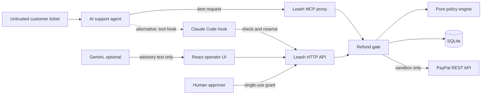
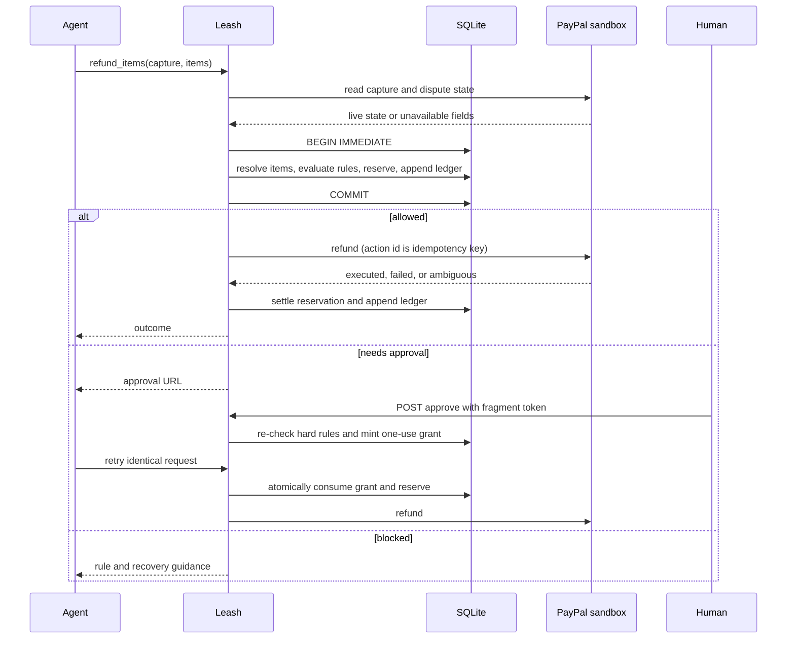

# Architecture

Leash is a single-process TypeScript service built around one principle: an AI proposes a refund, while deterministic code decides whether money may move. The default integration keeps PayPal credentials inside a narrow MCP proxy. A secondary Claude Code hook integration can gate an existing PayPal tool but is a best-effort guardrail, not a credential boundary.

## System context

Trust is intentionally asymmetric. Ticket text, agent reasoning, tool arguments, and all model output are untrusted. The operator host, mandate file, Leash process, SQLite database, and clock are trusted. Leash does not detect prompt injection; it limits what a successfully manipulated agent can do.

## Refund lifecycle

External I/O never happens inside the SQLite transaction. Live PayPal state is read first; one `BEGIN IMMEDIATE` transaction then calculates the rolling window, checks refundable balances, resolves item quantities, evaluates policy, reserves capacity, and appends the decision. PayPal executes afterward. This keeps lock duration short while preventing two local requests from spending the same capacity.

## Components

| Layer | Responsibility | Principal files |
|---|---|---|
| Domain | Types, mandate validation, deterministic rules, item resolution | `server/types.ts`, `config.ts`, `policy.ts` |
| Coordination | Decisions, reservations, approvals, expiry, settlement | `server/dispatch.ts`, `gate.ts` |
| Persistence | Driver abstraction, schema, ledger hash chain, optional seal | `server/db.ts`, `schema.ts`, `ledger.ts`, `seal.ts` |
| Integrations | PayPal sandbox client, MCP surface, Claude hooks, Gemini | `server/paypal.ts`, `proxy.ts`, `hooks/`, `llm.ts` |
| Delivery | Express API, static SPA, simulated demo | `server/app.ts`, `index.ts`, `demo.ts`, `web/` |
| Tooling | Seeding, reset, replay, doctor, benchmarks, video | `scripts/`, `video/` |

## Decision boundaries

- Hard rules—mandate expiry, invalid or unknown transactions, currency mismatch, over-capture, duplicate, disputes, return window, hard action cap, and hard daily cap—cannot be waived by approval.
- Soft rules—unavailable live state, daily agent cap, per-action agent cap, and full-order item refunds—may require a human.
- Item-scoped refunds derive price from merchant data by capture ID; the agent cannot provide a price.
- An approval URL carries a random token in its fragment. The database stores only its hash. Approving creates a grant; it never calls PayPal.
- A missing result becomes `unknown_outcome` after 120 seconds and continues consuming budget. This favors bounded exposure over availability.

## Security posture and limits

The credential-holding MCP proxy is the preferred boundary: the agent is never given PayPal credentials, and unsupported money tools are absent. Hooks are useful for integrating PayPal’s existing MCP tooling but can be bypassed by a determined agent with host and shell access. The guard hook covers common direct-call and configuration-tampering patterns, and `npm run doctor` verifies installation, but neither changes that trust limit.

The ledger detects partial edits, deletion, insertion, and reordering. A chain alone does not detect tail truncation or a full rewrite with recomputed hashes; an HMAC checkpoint stored outside the database adds protection against a database-only attacker. A party holding both database and seal key can rewrite and re-seal history.

## Scaling constraints

Leash is deliberately single-instance. SQLite `BEGIN IMMEDIATE`, in-memory rate-limit state, demo run state, and approval-summary caches assume one process. Horizontal scaling would require a shared transactional database, distributed rate limiting, durable demo/approval auxiliary state, and a reconciliation worker for ambiguous PayPal outcomes.
