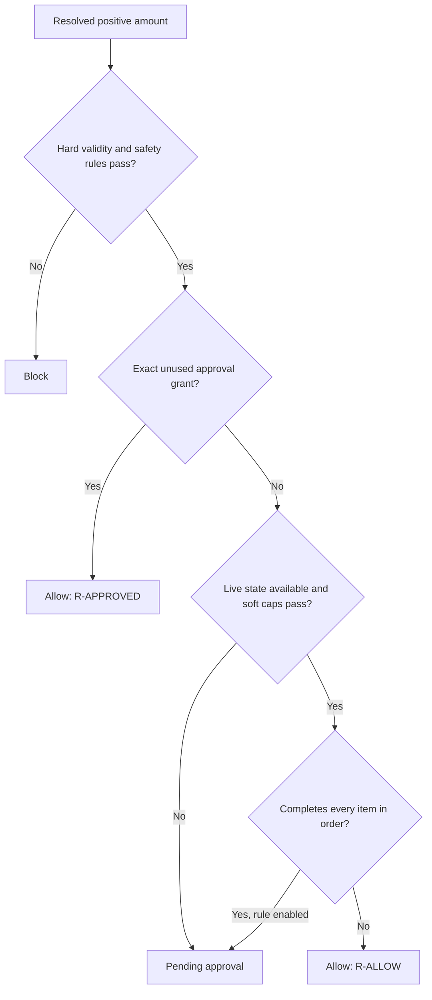

# Backend

The backend is native TypeScript executed directly by Node 22.18 or newer. Express serves the JSON API and built React application; the MCP SDK supplies a separate stdio proxy. No model participates in the authorization decision.

## Module guide

| Module | Role |
|---|---|
| `config.ts` | Strict whitelist parser for mandate schema v1 and plain-language playback |
| `policy.ts` | Pure `decide()` function plus trusted item-price and quantity resolution |
| `dispatch.ts` | Atomic checks, reservations, result settlement, approvals, expiry sweep, prevented-loss totals |
| `gate.ts` | Orchestrates state read, check, PayPal execution, and result recording |
| `paypal.ts` | Sandbox-only REST client, OAuth single-flight refresh, timeouts, error scrubbing, idempotent refund calls |
| `db.ts` | Common API over `better-sqlite3` and built-in `node:sqlite` |
| `ledger.ts` / `seal.ts` | Canonical serialization, SHA-256 chain verification, optional HMAC checkpoint |
| `app.ts` / `index.ts` | HTTP policy, routes, static SPA, port binding, shutdown, periodic sweep |
| `proxy.ts` / `proxy-main.ts` | Credential-holding stdio MCP server |
| `demo.ts` | Synthetic tickets and always-simulated two-lane workflow |
| `compiler.ts`, `llm.ts`, `brief.ts` | Draft policy compilation and sanitized advisory summaries |

## Policy evaluation

Rules are ordered and first-match wins. The canonical trigger details live in the [policy reference](POLICY_REFERENCE.md).



Required spending fields never receive silent defaults. Unknown mandate fields are rejected, and unset limits prevent activation. Optional behavior includes duplicate-window length, return window, open-dispute blocking, full-order escalation, and shadow mode.

## Reservation and settlement states

An allowed check becomes `reserved`. A successful tool or PayPal result becomes `executed` or `approved_executed`; a definite failure releases money and item reservations; an ambiguous result becomes `unknown_outcome` and stays counted. Pending approval holds item availability so concurrent approval requests cannot claim the same unit. The periodic sweep expires abandoned approvals and converts reservations older than 120 seconds to unknown outcomes.

Counted statuses for rolling limits are:

```text
reserved, executed, approved_executed, unknown_outcome
```

Blocked, denied, expired, failed, and shadow actions do not consume the rolling budget.

## Approval model

Escalation generates a 128-bit token, stores its SHA-256 hash, and places the clear token after `#t=` in the approval URL so it is not sent during the GET request. The approval itself is a POST. The pending link expires after 15 minutes. Approval re-evaluates hard rules against current stored state and mints a grant valid for 10 minutes. That grant is bound to the canonical hash of tool, capture, calculated cents, and sorted items, plus the session ID, and is consumed atomically once.

## PayPal integration

The client accepts only base URLs containing `sandbox`. OAuth tokens are cached; simultaneous refreshes share one promise, and a 401 triggers one refresh-and-retry. Requests have a default 10-second timeout. Refunds call Payments v2 and use the action ID as `PayPal-Request-Id`. Capture age and open disputes are fetched concurrently before the transaction; missing required state escalates instead of allowing.

## AI-assisted features

Gemini is optional and advisory:

- The approval summary treats the ticket as untrusted, strips control and bidirectional characters, caps input/output length, removes links, escapes markup, and falls back to a fixed template.
- The policy compiler performs three temperature-zero extractions. Disagreement or a failed run leaves a field unset. It produces a draft and cannot activate it through the web endpoint.

Neither output is read by `decide()`.

## Error behavior

- SQLite contention becomes HTTP 503 with `Retry-After: 1`.
- Invalid or oversized JSON becomes HTTP 400.
- Unexpected errors are logged without returning internals and produce HTTP 500.
- Hook crashes, malformed input, timeouts, and service failures exit with code 2 so Claude Code blocks the tool.
- PayPal error messages are scrubbed of the client secret and cached access token.

## Extending the backend

To add a money-moving tool, define an explicit schema, map it to trusted merchant state, add a deterministic policy rule, reserve all affected resources in the same transaction, expose it explicitly in the proxy or hook allowlist, and add concurrency, failure, approval, and unknown-outcome tests. Do not infer safety from a tool-name prefix.
