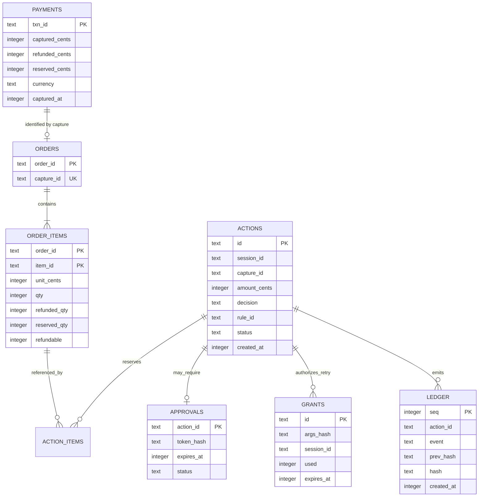

# Database decisions

Leash uses SQLite because the current product is a single-operator, single-instance sandbox application. It gives the gate a local transactional boundary without adding an external service. Both `better-sqlite3` and Node’s built-in `node:sqlite` implement the same small `Db` interface and run the same tests.

## Configuration

`LEASH_DB` selects the database path and defaults to `leash.db`. `LEASH_DB_DRIVER` may force `better-sqlite3` or `node:sqlite`; otherwise Leash tries `better-sqlite3` and falls back to `node:sqlite`.

Every connection enables WAL mode, `synchronous=NORMAL`, foreign keys, and a 3-second busy timeout. Prepared statements are cached by SQL string. Bind values are normalized because `node:sqlite` does not accept booleans or `undefined`.

## Schema



`action_items` also stores the resolved order, item, and quantity for each action. The schema is created with `CREATE TABLE IF NOT EXISTS`; there is currently no versioned migration framework.

## Transaction strategy

All policy checks that can race run in one synchronous `BEGIN IMMEDIATE` transaction:

1. Detect an idempotent repeat by action ID.
2. Read capture balances and the session’s rolling 24-hour spend.
3. Resolve requested item quantities and prices from trusted order rows.
4. Find and, if applicable, consume an exact approval grant.
5. Evaluate policy.
6. Reserve capture dollars and item quantities for an allowed action.
7. Persist the action and append its ledger event.
8. Commit.

Nested and asynchronous transaction callbacks are rejected. `BEGIN IMMEDIATE` obtains the write reservation before reads used for the decision, closing per-capture and rolling-budget races inside one process. PayPal network calls remain outside the transaction.

## Ledger design

Each event stores:

```text
hash = SHA-256(previous_hash || canonical_json({ actionId, event, payload, ts }))
```

Object keys are sorted during canonical serialization and the genesis hash is 64 zeroes. Decision events are appended in the same transaction as the state mutation. The UI and API can recompute the entire chain and show the current head.

An optional seal stores `{count, head, mac}` outside the database, where `mac` is an HMAC using `LEASH_LEDGER_KEY`. This detects a database-only attacker truncating or rewriting history before the sealed position. It does not protect against an attacker who also possesses the key or controls the running process.

## Retention and recovery

No automatic retention or compaction is implemented. Back up the database together with its WAL and SHM files using a SQLite-aware snapshot method, and protect any seal key separately. `npm run reset` deliberately deletes the local database plus WAL/SHM files and is intended only for disposable demo state.

On Render’s free configuration the database lives at `/tmp/leash.db`, so redeploys and restarts may erase it. That deployment is suitable for a demo, not durable audit storage.

## Why not Postgres yet?

The safety claims and tests rely on SQLite’s local transaction behavior and a single service instance. Moving to Postgres is appropriate when horizontal scaling or durable hosted storage is required, but it is not a connection-string swap: reservation queries, isolation behavior, migrations, distributed workers, rate limiting, and contention tests must all be redesigned and revalidated.
